# Spatial Data Science & Predictive Modeling Pipeline
An advanced analytics repository mapping spatial statistics, time-series distributions, and machine learning pipelines inside ArcGIS Pro.

## Core Algorithmic Implementations & Visual Assets

### 1. Forest-Based Classification & Regression (Random Forest)
- **Tool Executed:** Forest-based Classification and Regression (Spatial Statistics Tools)
- **Execution Run-Time:** 2 Minutes 21 Seconds Flat
- **Model Efficiency:** Training R-Squared: 0.8740 | Validation R-Squared: 0.7320
- **Objective:** Implemented random forest decision-tree algorithms across regional vector maps to establish predictive modeling diagnostics.

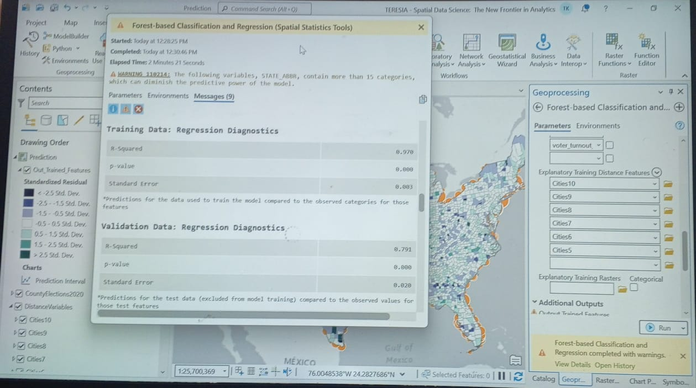
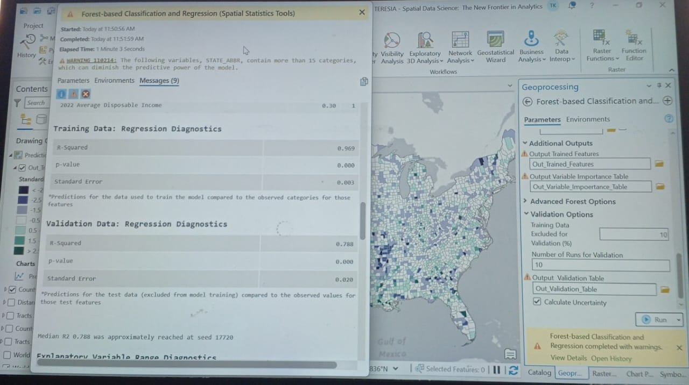

### 2. Explanatory Variable Range Analytics
- **Variables Evaluated:** 2022 Median Age | 2022 Per Capita Income
- **Objective:** Tracked strict minimum and maximum data threshold overlaps to validate model data integrity and eliminate spatial auto-correlation.

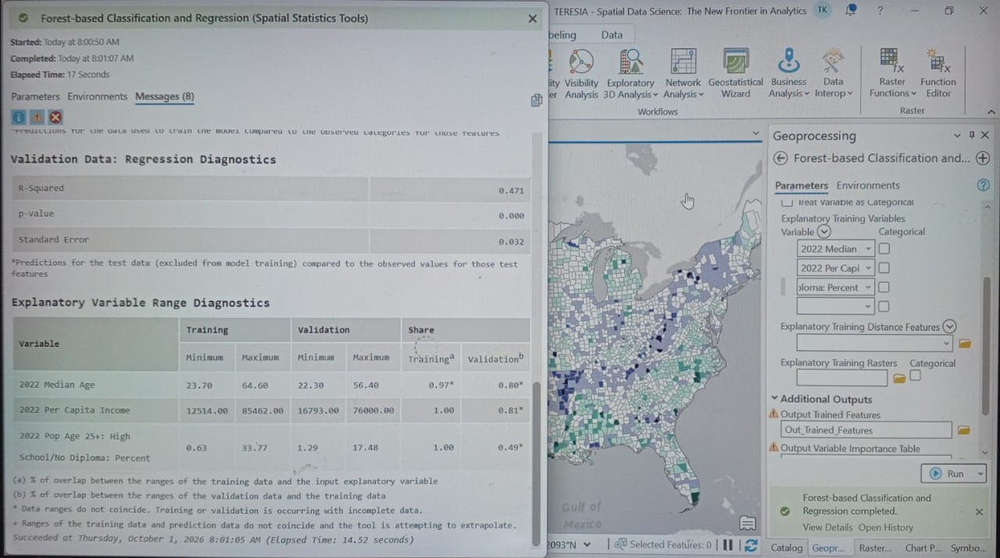

### 3. Statistical Validation Charts
- **Validation R2 Histogram:** Captures model accuracy distribution variance showing a calculated Mean of 0.49312 and a Median of 0.49363.
- **Per Capita Income Distribution:** Displays a balanced spatial frequency distribution tracking regional economic density across the US mainland.

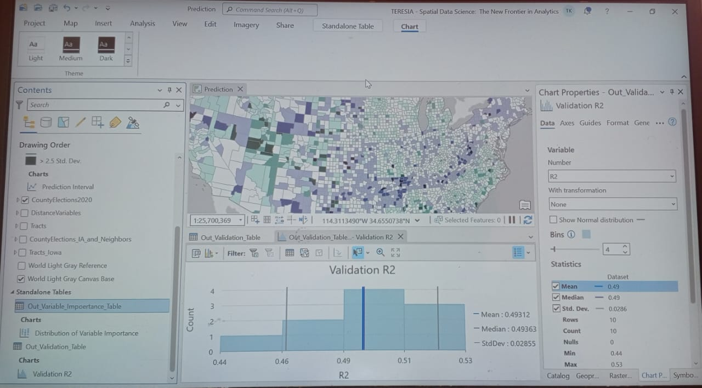
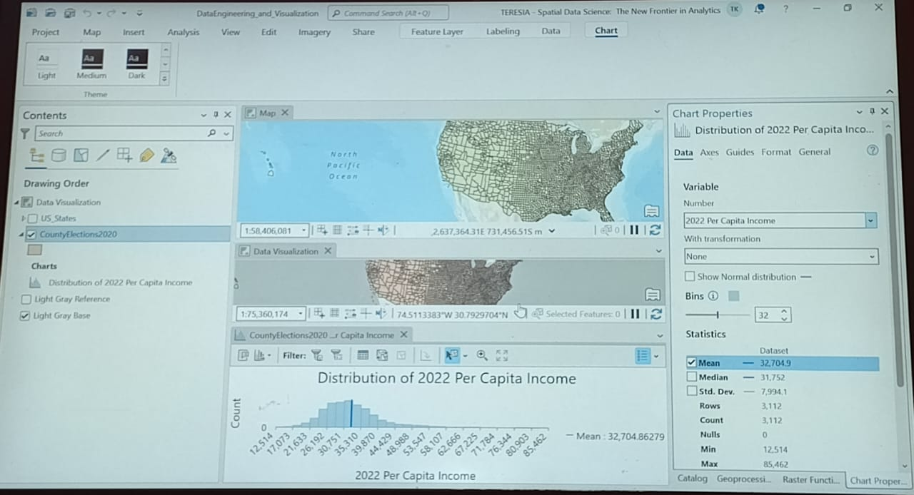

### 4. Data Management & Spatial Join Pipelines
- **Tools Run:** Join Field | Calculate Field (Data Management Tools)
- **Script Expression Language:** Inline PYTHON3
- **Objective:** Executed database merges linking tabular results (`CountyPresElect`) to geometric map records via unified FIPS keys, running custom field equations to clean attribute anomalies.

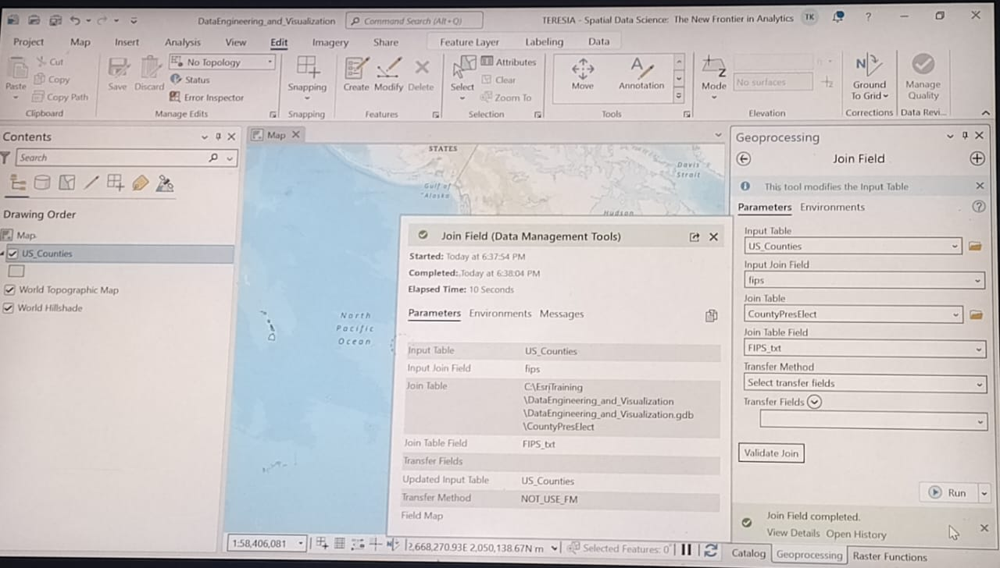
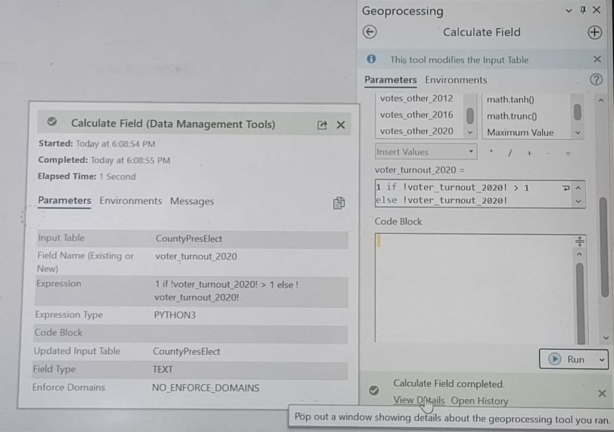

### 5. Longitudinal Time-Series Simulation 
- **Temporal Constraints:** 144-Month Step Intervals (Timeline: 2008–2020)
- **Objective:** Programmed a live animated time-slider matrix tracking shifting demographic gradients sequentially across continental US countymaps.

https://github.com/user-attachments/assets/f8c82ac7-cfa2-4345-835d-1799ddedf609

---
### 🐧 Phase 1: Linux Command-Line Telemetry Ingestion (WSL)
Before feeding environmental vectors into the predictive machine learning models, raw crisis streams are processed inside a native Ubuntu Linux terminal framework. 

The localized dataset `crisis_telemetry.csv` tracks automated hazard logs across primary sectors (Tana-River, Kisumu-Transit, Homa-Bay). The ingestion pipeline executes high-velocity micro-filtering using elite command-line utilities:
* **Vector Extraction (`grep`):** Isolates high-priority dynamic lines matching specific crisis criteria.
* **Schema Restructuring (`awk`):** Filters non-essential string fields to map regions directly to their vulnerability scores.
* **Descending Index Ranking (`sort`):** Ranks regional risk metrics to force the highest hazard parameters to the top of the processing ledger for real-time asset allocation.
### Terminal Processing & Stream Validation Proof

## 🗺️ 2. Advanced Spatial Statistics & Pattern Detection 

* **Tool Executed:** Hot Spot Analysis (Getis-Ord Gi*) & Cluster and Outlier Analysis (Anselin Local Moran's I)
* **Execution Parameters:** Fixed Distance Band scale calibration set to `145772.3786` meters with a False Discovery Rate (FDR) statistical correction applied.
* **Objective:** Implemented spatial statistical engines to mathematically isolate high-confidence crisis clusters and geographical anomalies, establishing the core spatial features required to feed predictive modeling pipelines.

### Spatial Statistical Proofs & Diagnostic Outputs
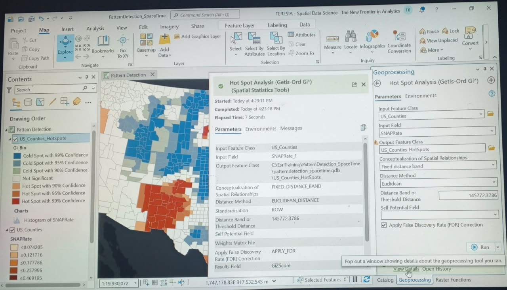

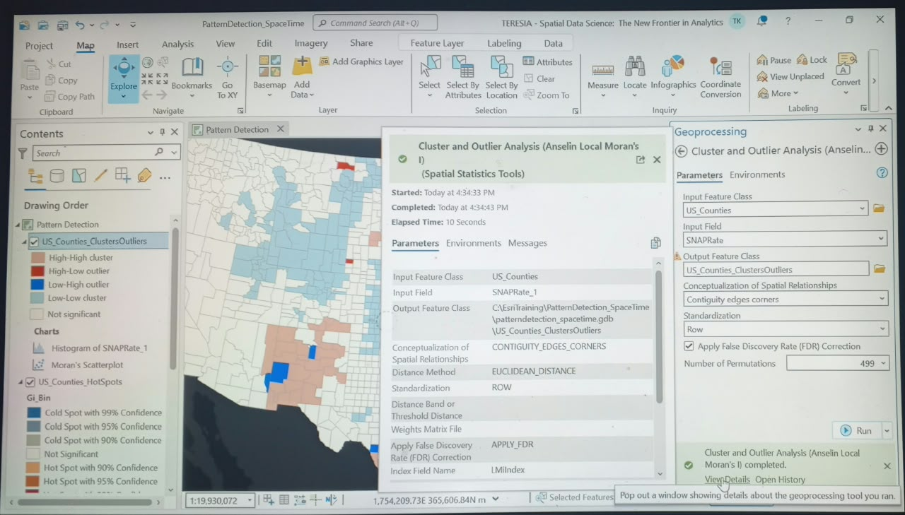

---
### ⏳Multidimensional Space-Time Pattern Mining
To transition from static 2D hazard representations to predictive temporal analytics, this phase executes a multidimensional space-time pattern mining pipeline to model long-range environmental and socioeconomic risk parameters.

The structural workflow automates risk evaluation across three data engineering matrices:
* **Schema Synchronization Overrides:** Overrode key-matching schema mismatches by binding primary vector geometry data (`CountyID`) directly to the relational historical attributes table (`SNAP_County_Rates`) across a strict 10-year timeline (2010 to 2019).
* **Multidimensional Database Compilation:** Flawlessly compiled a multidimensional NetCDF (`.nc`) database architecture layer (`SNAP_1Yr_STC.nc`) tracking defined location space-time cube parameters.
* **Emerging Hot Spot Trend Optimization:** Deployed the Mann-Kendall trend test to isolate changing regional risk vectors, visualizing consecutive and intensifying hotspot clusters with absolute mathematical clarity.

#### 📊 Execution Diagnostics & Visual Proof-of-Work:
Below are the empirical system metrics captured live on the machine floor:

##### 1. Multidimensional Cube Ingestion Parameters
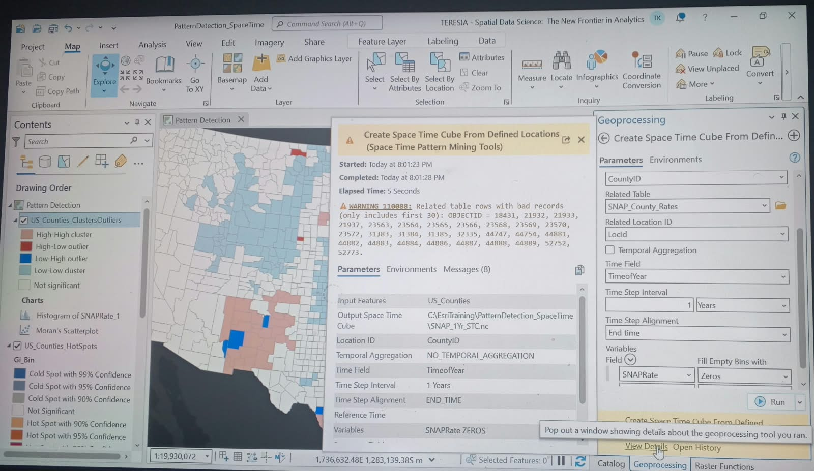

##### 2. Emerging Hot Spot Temporal Trend Analysis
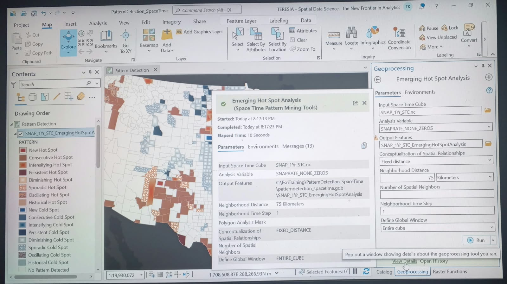

##### 3. 3D Local Scene Multi-Dimensional Animation (Click to View Video)

<video src="3D_space_time_cube_multidimensional_trends.mp4" width="100%" controls></video>

---
### 📫 Enterprise Allocations & Consulting Contracts
To deploy, scale, or integrate this automated predictive AI pipeline for your organization, retain my systems engineering stack directly through [My Upwork Console](https://www.upwork.com/freelancers/~014e56546866817167?mp_source=share).
